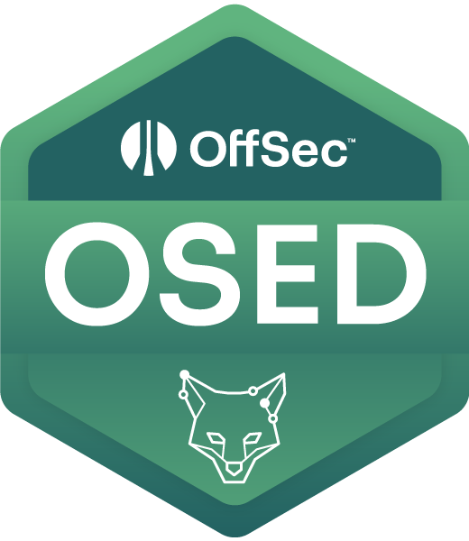
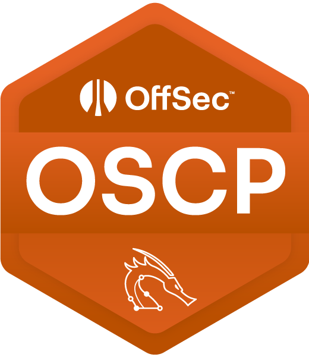
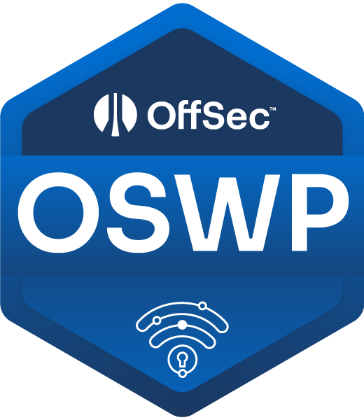
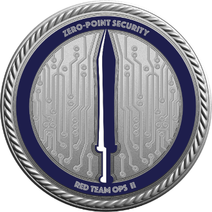
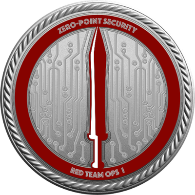
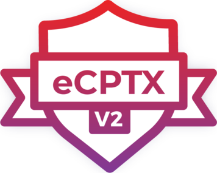
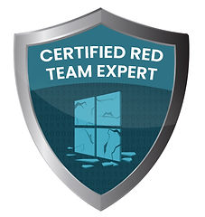

# Welcome, dear visitor!

# Whoami?
I am Jethro, a cybersecurity professional with specialization on offensive security (AD, Network, and web penetration testing). I also do research Defense Evasion and Restriction bypasses focused in Windows Environment. I am also active on joining CTFs and passionate on doing some personal projects. I mainly have experience on Web, reverse engineering, binary exploitation, and malware analysis challenges. You may see the writeups available here if you are interested. 

# Certifications

#### Offensive Security Exploit Developer (OSED)
[{: .img-icon }](https://credentials.offsec.com/2c6e0ce4-a545-4b93-9f8b-46169d41af9f)

#### Offensive Security Certified Professional (OSCP)
[{: .img-icon }](https://credentials.offsec.com/3a3c228a-9439-43ab-8330-c2c5b2a6f118)

#### Offensive Security Wireless Professional (OSWP)
[{: .img-icon }](https://credentials.offsec.com/63770a3d-80e9-48d7-b8dc-05841ca75805)

#### Certified Red Team Lead (CRTL / CRTO II)
[{: .img-icon }](https://badges.parchment.eu/public/assertions/MZzPVHIpT0Gkv46GNB05pQ)

#### Certified Red Team Operator (CRTO)
[{: .img-icon }](https://badges.parchment.eu/public/assertions/LqFEIIA6SlaMBXn4AxcLIQ)

#### eLearnSecurity Certified Penetration Tester eXtreme (eCPTX)
[{: .img-icon }](https://certs.ine.com/b2813114-9e8d-4c3c-b5f8-fc75f31a1e02)

#### Certified Red Team Expert (CRTE)
[{: .img-icon }](https://www.credential.net/3f3a3a28-5df5-4824-9ae7-a5e0346d239c)

